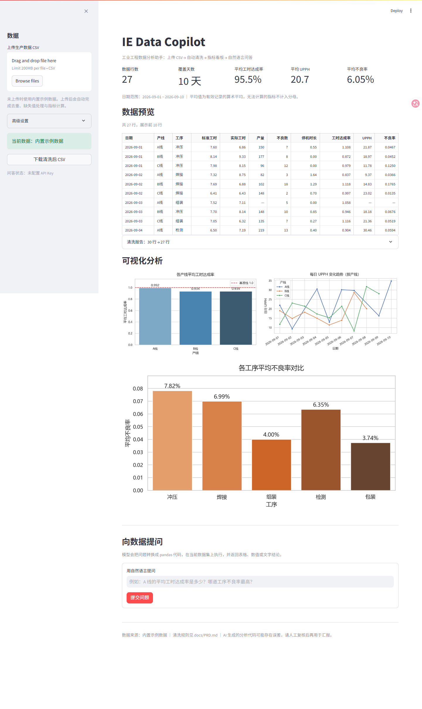
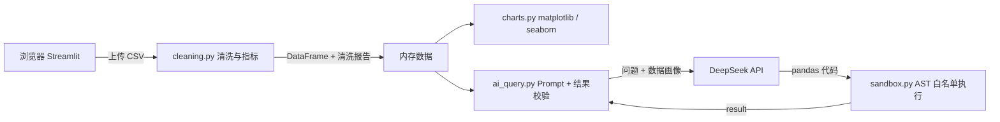

# IE Data Copilot

> 面向工业工程（IE）的轻量数据分析助手：上传产线工时 CSV，自动完成清洗与指标计算，用看板看趋势，用自然语言直接问数据。




## 为什么做这个

IE 工程师的大量时间花在重复劳动上：手工去重、补缺失值、拉公式算达成率和 UPPH、再截图做周报。

- 数据口径不统一，同一个月两张报表对不上；
- 想看一个指标就得重新写 SQL 或 pandas；
- 图表和结论散落在多个文件里，汇报时反复解释。

IE Data Copilot 把「清洗 → 指标 → 看板 → 问答」串成一条链路：上传即出结果，想问什么直接问，重要结论还能看到模型生成的代码。

## 核心功能

| 模块 | 能力 | 说明 |
| --- | --- | --- |
| 自动清洗 | 去重、日期解析、缺失值处理、类型转换 | 上传原始 CSV 即可，清洗过程写入可追溯的报告 |
| 指标计算 | 工时达成率、UPPH、不良率 | 实际工时 ≤ 0 时比率记为空值，避免虚假的 0 |
| 数据看板 | 产线达成率、每日 UPPH 趋势、工序不良率 | 图表在内存中生成，多用户并发不串图 |
| 自然语言问答 | 问题 → pandas 代码 → 表格/数值/结论 | 问答基于当前上传的数据集，不是写死的示例 |
| 安全执行 | AST 白名单 + 安全 builtins + 超时 | 拦截 import、文件读写、系统调用与下划线属性 |
| 结果导出 | 一键下载清洗后 CSV | UTF-8 BOM，Excel 直接打开不乱码 |

## 快速开始

环境要求：Python 3.9+（推荐 3.11 / 3.12）。

Windows PowerShell：

```powershell
git clone https://github.com/stringzi/ie-data-copilot.git
cd ie-data-copilot
python -m venv .venv
.\.venv\Scripts\Activate.ps1
pip install -r requirements.txt
Copy-Item .env.example .env    # 填入 DEEPSEEK_API_KEY
streamlit run app.py
```

macOS / Linux：

```bash
git clone https://github.com/stringzi/ie-data-copilot.git
cd ie-data-copilot
python3 -m venv .venv
source .venv/bin/activate
pip install -r requirements.txt
cp .env.example .env           # 填入 DEEPSEEK_API_KEY
streamlit run app.py
```

打开 `http://localhost:8501`。未配置 API Key 时，清洗、看板和图表仍可正常使用，只有问答不可用。

也可以在侧边栏「高级设置」里临时填写 Key（仅保存在当前会话），或使用环境变量 `DEEPSEEK_API_KEY`。部署到 Streamlit Cloud 时推荐写进 `st.secrets`。

## 数据格式

上传的 CSV 至少包含以下列（表头支持 UTF-8 BOM 与 GB18030 编码）：

| 字段 | 类型 | 是否必需 | 说明 |
| --- | --- | --- | --- |
| 日期 | date | 是 | `2026-09-01` 或 `2026/9/1` |
| 产线 | string | 是 | 如 `A线`、`B线`，不限于 A/B/C |
| 工序 | string | 是 | 如 `冲压`、`焊接`、`组装` |
| 标准工时 | float | 是 | 计划工时（小时） |
| 实际工时 | float | 是 | 实际用工时（小时） |
| 产量 | int | 是 | 产出件数，缺失会保留为空值 |
| 不良数 | int | 是 | 不良件数 |
| 停机时长 | float | 是 | 停机小时数，缺失按 0 处理 |
| 工时达成率、UPPH、不良率 | float | 否 | 由程序计算，上传时无需提供 |

内置示例数据位于 `data/raw/simulated_production_hours.csv`，包含重复行、缺失值和脏日期，用于演示清洗效果。

## 使用流程

1. 侧边栏上传 CSV，或直接使用内置示例数据；
2. 查看 KPI 与清洗报告，确认删除了多少重复行、填充了哪些字段；
3. 看三张图：产线达成率、每日 UPPH 趋势、工序不良率；
4. 在「向数据提问」里输入问题，得到表格/数值，并可展开查看生成的 pandas 代码；
5. 需要的话点击「下载清洗后 CSV」带走结果。

## 示例问题

- 各产线的平均工时达成率分别是多少？
- 哪道工序的不良率最高？
- 9 月 1 日到 9 月 5 日每日 UPPH 的变化趋势如何？
- 停机时长最长的产线是哪条？
- 产量和 UPPH 的相关性如何？
- 上周 A 线达成了多少？（“上周”以数据最新日期为基准）

## 项目结构

```text
ie-data-copilot/
├─ app.py                        # Streamlit 入口
├─ ie_copilot/
│  ├─ cleaning.py                # 清洗 + 指标 + 清洗报告
│  ├─ charts.py                  # 返回内存 Figure 的三张图
│  ├─ ai_query.py                # Prompt、问答流程、结果校验
│  ├─ sandbox.py                 # 生成代码的 AST 白名单沙箱
│  ├─ data.py                    # CSV 读写与示例数据
│  └─ config.py                  # 路径与模型配置
├─ scripts/
│  ├─ build_cleaned_data.py      # 重建 data/processed
│  └─ export_charts.py           # 导出 assets/charts
├─ tests/                        # unittest 单元测试
├─ data/
│  ├─ raw/                       # 原始示例数据
│  └─ processed/                 # 清洗结果 + 清洗报告 JSON
├─ docs/
│  ├─ PRD.md                     # 产品需求文档
│  └─ design/preview.html        # 早期界面设计稿
├─ assets/                       # README 截图与图表
└─ .github/workflows/ci.yml      # ruff + unittest
```

## 技术架构



技术栈：Python 3.9+、Streamlit、pandas、NumPy、matplotlib、seaborn、OpenAI 兼容 SDK（DeepSeek）。

## 指标口径

- 工时达成率 = 标准工时 / 实际工时，1.0 表示刚好达成；
- UPPH = 产量 / 实际工时（Unit Per Person Hour）；
- 不良率 = 不良数 / 产量；
- 看板上的产线/工序平均值为「逐行计算比率后的算术平均」，无法计算的记录不计入分母；
- 若需要「总标准工时 / 总实际工时」的汇总口径，直接在问答里说明“按总量计算”。

## 清洗与异常校验

- 完全重复行自动删除；日期非法或缺失的行会被剔除并计入报告；
- 产线/工序按同组众数填充，标准工时/实际工时按「产线 + 工序」中位数填充，极端情况下用全表中位数兜底；
- 产量缺失不再填 0：对应 UPPH 与不良率保留为空值，避免趋势图上出现假暴跌；
- 停机时长缺失按 0 处理（视为未记录停机），并在报告中提示；
- 业务校验：实际工时 ≤ 0、不良数 > 产量、负值、同日同产线同工序重复，都会在报告里单独列出；
- 问答结果校验：空结果、超 200 行、非有限数值、超长文本都会给出提示。

## 安全与隐私

- 模型生成的代码不会直接执行：先做 AST 白名单检查（禁止 import、文件读写、系统调用、下划线属性），再放进只暴露 `pd` / `np` / `df` 的命名空间运行，并设置超时与结果大小限制；
- 这不是容器级隔离。若部署到公网，请在容器中运行并限制 CPU/内存，同时限制单用户调用频率；
- 问答会把「字段画像 + 前 5 行样例」发送给 DeepSeek。不要上传涉密或含个人信息的真实生产数据，演示请使用脱敏数据；
- API Key 支持环境变量、`.env`、`st.secrets` 与侧边栏临时输入，不会写入仓库。

## 测试

```bash
python -m unittest discover -s tests -v
```

覆盖清洗规则、指标公式、动态产线、空数据处理、沙箱拦截、Prompt 构造与问答端到端流程（使用假客户端，不消耗 API 额度）。CI 在 Python 3.10 与 3.12 上运行 ruff 与测试。

## Roadmap

- [ ] 问答结果自动出图，并给出一句话结论（对齐「输入问题 → 输出图表 + 结论」）
- [ ] 清洗规则可配置（填充策略、异常阈值）
- [ ] 增加 OEE、稼动率、直通率等 IE 指标
- [ ] 多文件合并与日期区间对比
- [ ] Docker 镜像与一键部署
- [ ] 基于 3σ / IQR 的异常点检测

## 文档

- 产品需求文档：[docs/PRD.md](docs/PRD.md)
- 早期界面设计稿：[docs/design/preview.html](docs/design/preview.html)

## License

[MIT](LICENSE)
